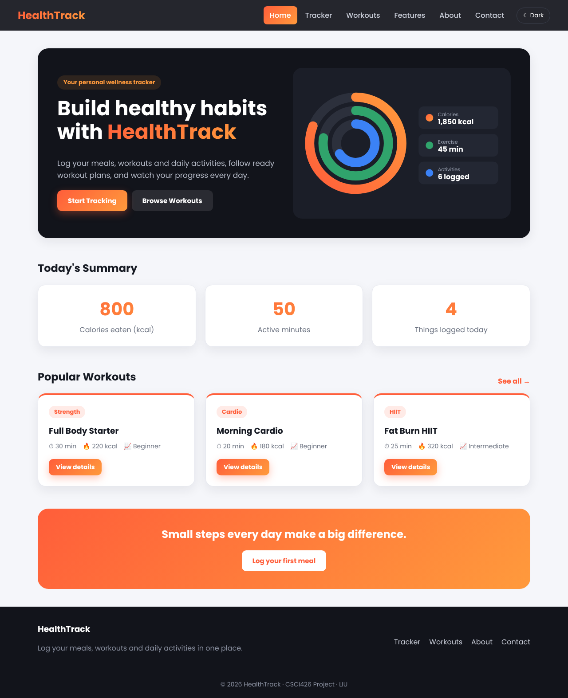
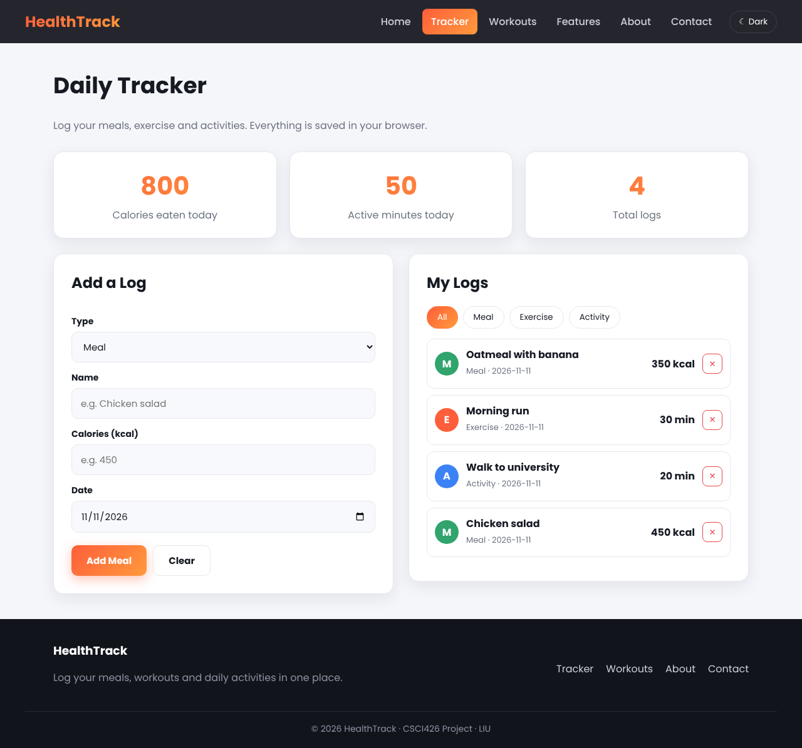
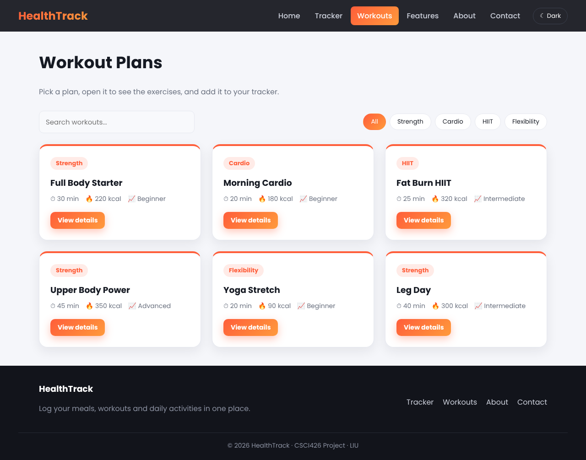
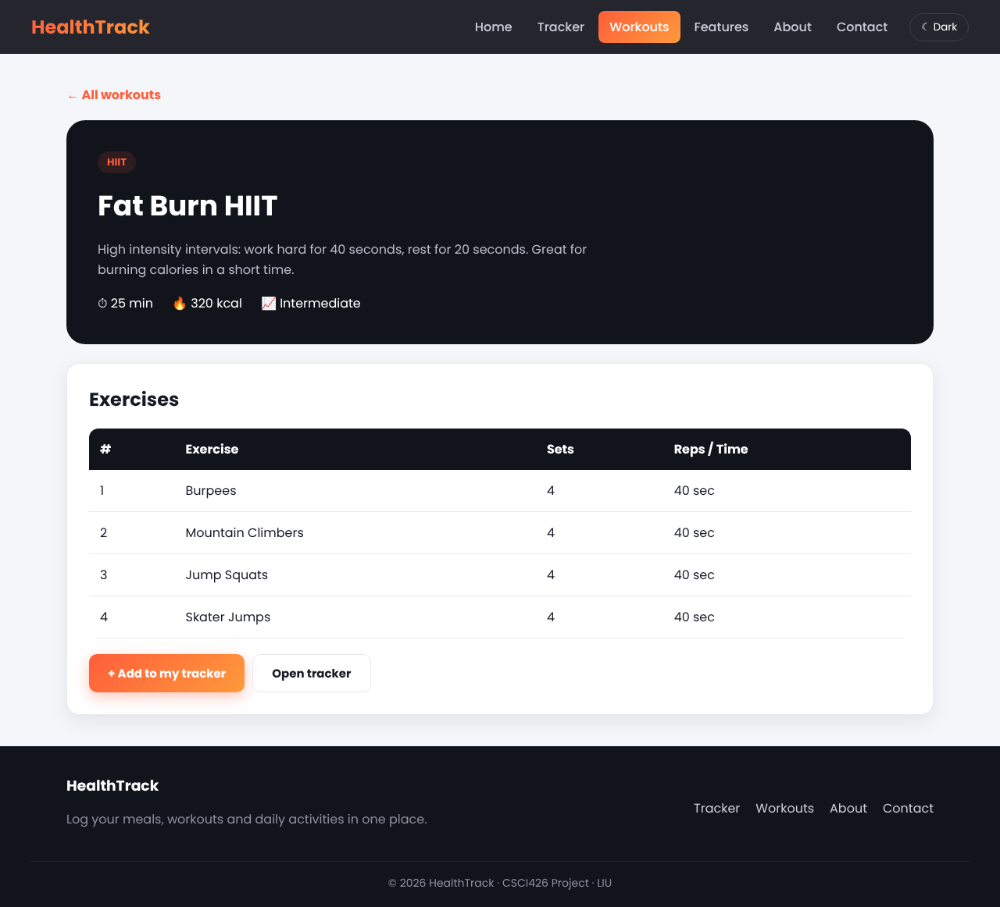
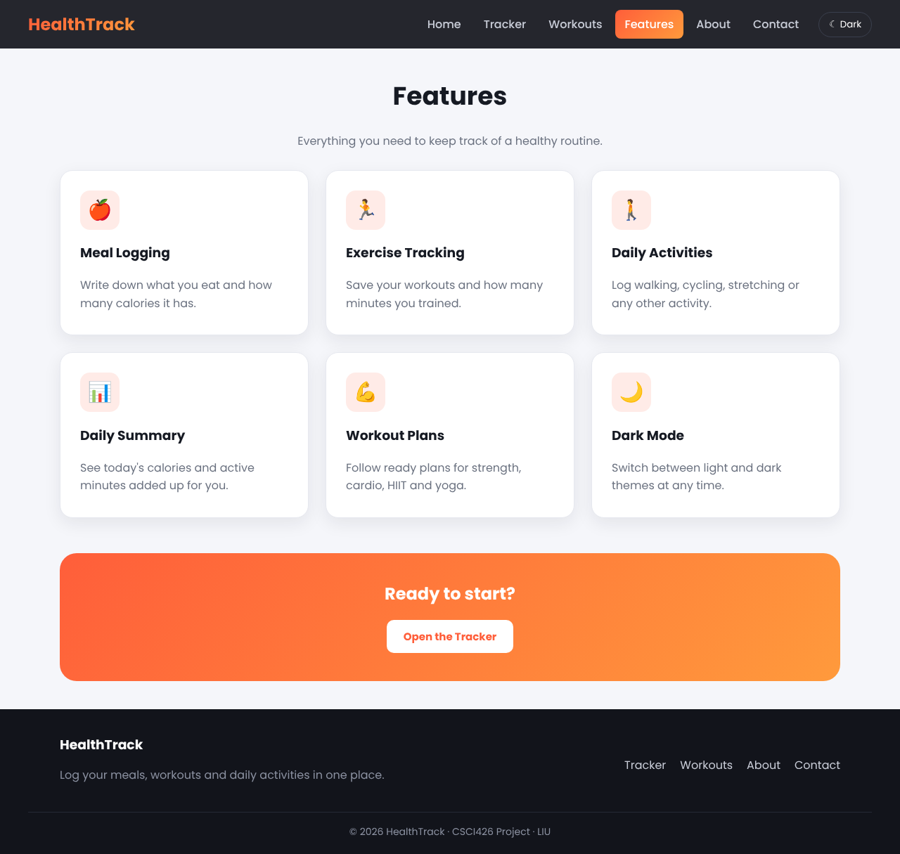
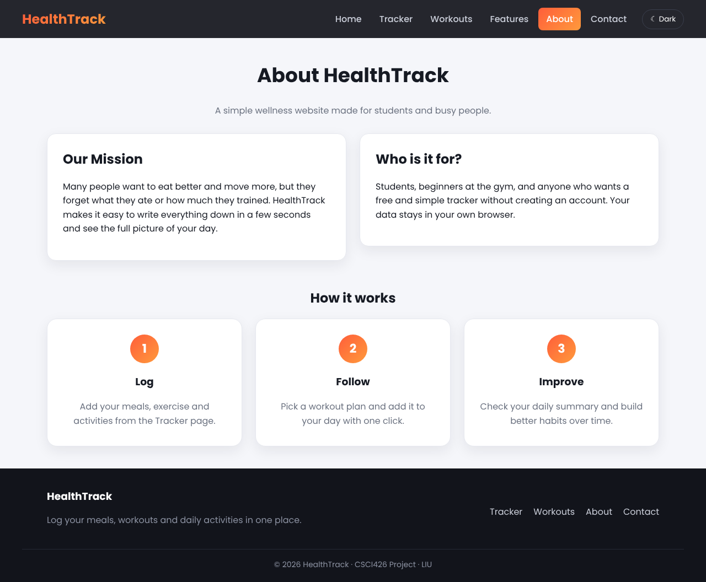
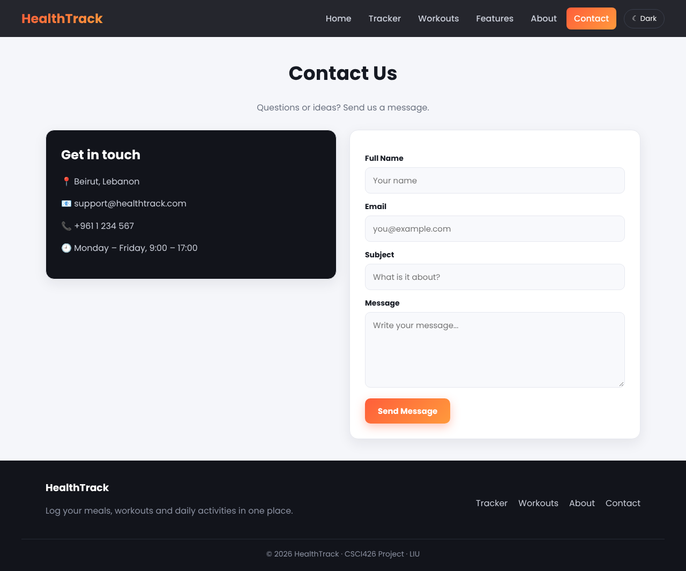
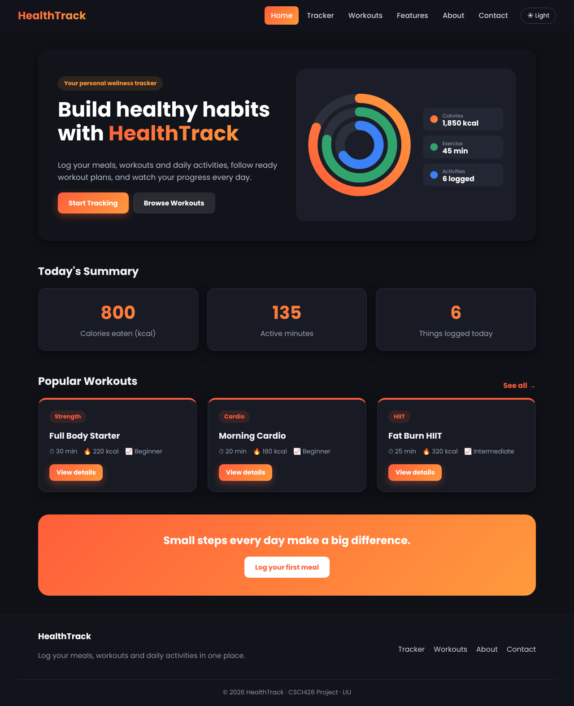
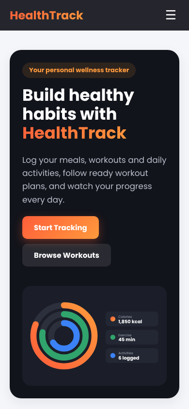
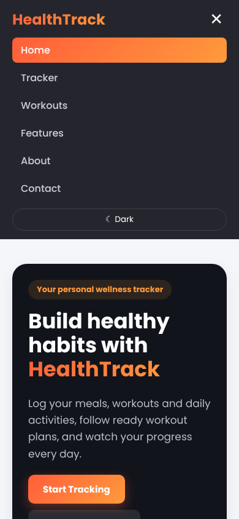

# HealthTrack – Fitness & Wellness Tracker

HealthTrack is a personal wellness website built with **ReactJS** for the CSCI426 Advanced Web Programming project (LIU, Fall 2026). It helps users log their daily **meals, exercise and activities**, see a summary of their day, and follow ready **workout plans**.

All the data is saved in the browser with `localStorage`, so the app works without a backend or an account.

**Live demo:** https://healthtrack-1.netlify.app
**Author:** Ali Mostafa

---

## Features

- **Daily Tracker**: add meals (calories), exercise and activities (minutes), with form validation
- **Today's summary**: calories eaten, active minutes and number of logs, calculated automatically
- **Filters**: show all logs or only meals, exercise or activities
- **Workout plans**: search by name and filter by category (Strength, Cardio, HIIT, Flexibility)
- **Dynamic workout page** (`/workouts/:id`): each plan has its own page with its exercises, and an "Add to my tracker" button
- **Contact form** with validation (required fields, email format, message length)
- **Light / Dark mode**, remembered after a refresh
- **Responsive design**: works on desktop, tablet and mobile (☰ menu on small screens)
- **404 page** for wrong links

## Pages

| Route | Page | Description |
|---|---|---|
| `/` | Home | Hero section, today's summary, popular workouts |
| `/tracker` | Tracker | Add, filter and delete daily logs |
| `/workouts` | Workouts | All workout plans with search and filters |
| `/workouts/:id` | Workout Details | **Dynamic page**: one page for each workout |
| `/features` | Features | What the app can do |
| `/about` | About | Mission and how it works |
| `/contact` | Contact | Contact info and a validated form |

## Technologies

- ReactJS 18 (Create React App)
- React Router DOM 6 (`BrowserRouter`, `Routes`, `Route`, `NavLink`, `useParams`)
- React Hooks: `useState`, `useEffect`
- `localStorage` for saving data
- Plain CSS with CSS variables (for the two themes), Flexbox, Grid and media queries
- JSON file for the workout data
- Git and GitHub for version control; Netlify or Vercel for hosting

## Project Structure

```
web2project/
├── public/
│   ├── index.html
│   └── _redirects          ← lets Netlify open links like /workouts/3 directly
├── src/
│   ├── assets/hero.svg
│   ├── components/
│   │   ├── Navbar.js
│   │   ├── Footer.js
│   │   ├── StatCard.js
│   │   └── WorkoutCard.js
│   ├── data/workouts.json
│   ├── pages/
│   │   ├── Home.js
│   │   ├── Tracker.js
│   │   ├── Workouts.js
│   │   ├── WorkoutDetails.js
│   │   ├── Features.js
│   │   ├── About.js
│   │   ├── Contact.js
│   │   └── NotFound.js
│   ├── App.js
│   ├── App.css
│   └── index.js
├── screenshots/
├── vercel.json             ← same as _redirects, for Vercel
└── README.md
```

## Setup Instructions

You need **Node.js** (version 18 or newer) installed.

```bash
# 1. clone the project
git clone https://github.com/alimoustapha/<repo-name>.git
cd <repo-name>

# 2. install the packages
npm install

# 3. run it on http://localhost:3000
npm start

# 4. (optional) build the production version
npm run build
```

## Deployment

**Netlify:** connect the GitHub repo. Build command: `npm run build`. Publish directory: `build`.
**Vercel:** import the GitHub repo. Vercel detects Create React App by itself.

The `_redirects` and `vercel.json` files make refreshing a page like `/workouts/3` work on the live site.

## Screenshots

### Home


### Daily Tracker


### Workout Plans


### Workout Details (dynamic page)


### Features


### About


### Contact


### Dark Mode


### Mobile
<p>
  
  
</p>
